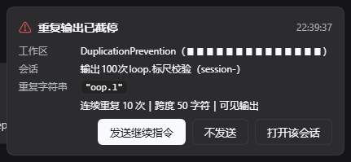
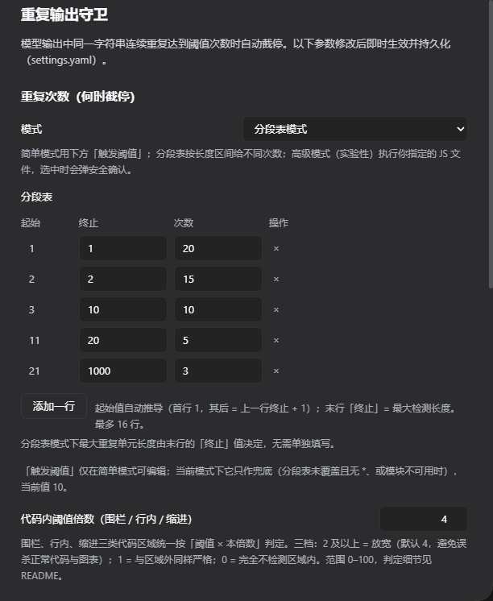
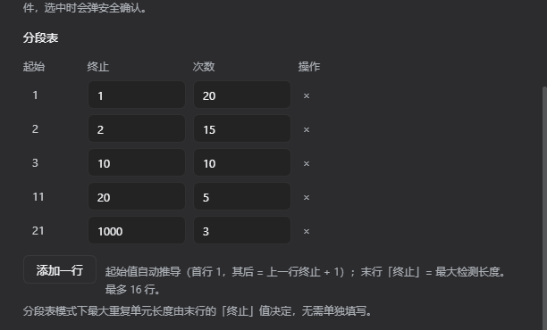
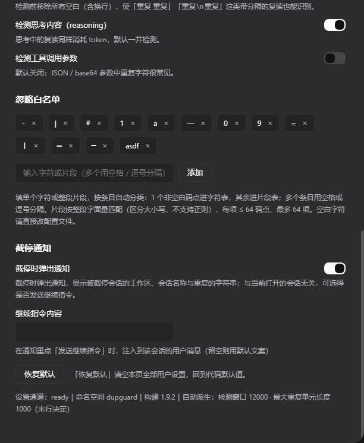
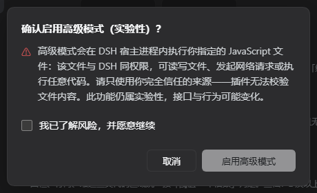

# dupguard · DSH 大模型重复输出守卫

[English](README.en.md)

[](https://www.npmjs.com/package/dsh-dupguard)
[](LICENSE)
[](https://github.com/zqh260619/dsh-dupguard/actions/workflows/ci.yml)
[](https://github.com/topics/dsh-plugin)
[](https://dsh-plugin.org/plugins/zqh260619/dsh-dupguard)
[](https://www.dsh.so/artifact/dsh-dupguard/)
[](https://awesome-dsh-plugin.com)

> **dupguard** 是 [DeepSeek Harness (DSH)](https://github.com/deepseek-ai/deepseek-harness) 的实时重复输出守卫插件：最新输出中同一字符串连续重复 **10 次及以上**（可配置）时立即停止本次生成，已生成内容正常提交为助手消息。

<sub>徽章由 npm / GitHub / dsh-plugin.org / dsh.so / awesome-dsh-plugin 各自生成；本插件的版本-兼容矩阵见
[兼容性报告](docs/compatibility-report.md)。问题与建议请提到 [GitHub Issues](https://github.com/zqh260619/dsh-dupguard/issues)。</sub>

## 截图

| 截停通知（可选择是否继续） | 被截停的那一轮：输出停在阈值处 |
| --- | --- |
|  |  |

| 设置页：重复次数（分段表模式） | 分段表：按单元长度决定次数 |
| --- | --- |
|  |  |

| 设置页：忽略白名单与截停通知 | 高级模式（实验性）风险确认 |
| --- | --- |
|  |  |

| 系统通知（可选，Windows 右下角） | |
| --- | --- |
|  | |

> 7 张图的展示顺序同时声明在 [screenshots.json](screenshots.json)（供插件市场 / 商店读取）；截图中的工作区路径已打码。
> 第 7 张取自桌面版（Electron），通知署名是应用本身；网页版的通知由浏览器转发，署名是浏览器。

## 快速开始

**前置要求**：DSH **≥ 0.1.2-rc.1**（一条命令安装；宿主 API 下限为 ≥ 0.1.1-rc.1）、**Node ≥ 20**、以及你要装到的
profile 名（下面示例用 `web`）。

```bash
dsh plugin --profile web add dsh-dupguard      # 把 web 换成你的 profile 名
```

**重启 DSH 即生效**（宿主代码只在进程启动时加载）。看到这两处就说明装好了：

1. 设置页多出「重复守卫」分节，底部显示 `设置通道：ready｜构建 1.10.2｜自动派生：检测窗口 …`；
2. 宿主日志出现 `[dupguard] 生效参数：…`（**判断设置是否真的生效，只认这一行**）。

默认值开箱可用：连续重复 **≥ 10 次**即截停（已生成内容照常提交为助手消息），思考文本一并检测，**代码区域**
（围栏代码块、行内代码、缩进代码块三类统一）内按 **4 倍**放宽。想调整就在设置页改——**改完无需重启**
（写回 `cordis.patch.yml`，宿主自行热读取）。

> 桌面版（Electron）：**请在应用内「设置 → 插件」页面安装**（`desktop` profile 由应用独占管理，CLI 会被拒绝）。
> 卸载 / 升级：`dsh plugin --profile web remove|update dsh-dupguard`；其它安装方式（本地仓库 `--patch` 挂载 /
> 动态插件 / 手工补丁层 / 临时禁用）见 [备选安装方式](#备选安装方式)。

## 兼容性

| 项目 | 支持范围 |
| --- | --- |
| 宿主 API | ≥ `0.1.1-rc.1`（`package.json` 的 `dsh.compatibility` 声明值）；一条命令 bundle 安装需 ≥ `0.1.2-rc.1` |
| 已实测通过（仓库内有记录） | **DSH 0.2.1-rc.2（CLI / web profile 与桌面版，2026-10-20 复核）**、**DSH 0.2.1-rc.1（CLI / web profile，2026-10-17 复核）**、**DSH 0.2.0-rc.2（CLI / web profile 与桌面版）**（见 [兼容性报告](docs/compatibility-report.md)）；`0.1.7-rc.2`、`0.1.7-rc.1`、`0.1.2-rc.1`、`0.1.1-rc.1`（见 CHANGELOG 对应条目） |
| 早期版本（未在本仓库留档） | `0.1.5-rc.2`、`0.1.6-alpha.2` 曾在使用中验证过，但仓库内没有当时的记录，故不计入上方清单 |
| Node | ≥ 20（与 DSH 一致，不支持 Node 18）；`.mjs` 高级模块依赖运行时的 `require(ESM)` 支持（Node ≥ 20.19 / ≥ 22.12 已内置，更早版本回退并告警） |
| 设置命名空间 | 0.1.7 起 = loader entry id（本 bundle 为 `include:dupguard`）；≤ 0.1.6 为 `dsh-dupguard`。1.6.0 起运行时自动选路，**无需按 DSH 版本换插件版本** |
| 升级提示 | **0.1.7 起设置键从 `dsh-dupguard:` 变为 `dupguard:`**，升级后请在设置页重新保存一次（或把旧键内容手工挪到新键下） |

- 结论：**升级 0.2.x（含 0.2.1-rc.2 / rc.1）无需改配置或换版本**；桌面版与 CLI 同版本，上述 API 结论全部适用。
- **旧版本配置直接沿用**：配置键自 1.0.0 起**只增不减、从未改名**（1.0.0 七项 → 1.0.2 `ignoredChars` → 1.4.0
  `skipCodeBlocks`/`codeBlockMultiplier` → 1.7.0 `ignoredSubstrings` → 1.8.0 `thresholdMode`/`thresholdByLength`/
  `advancedThresholdFile`），取值范围**只放宽过**（`codeBlockMultiplier` 由 1–100 放宽到 0–100，其余自 1.3.0 起未变），
  缺失的键一律取默认值；配置里出现当前 schema 未声明的键（如 `fixStandingMountConflict`、拼写错误）会被**忽略**
  而不是让整节设置失效 ⇒ **当年通过设置页保存的配置，升级后行为不变**（回归用例 S23 覆盖：键只增不减 +
  取值范围只放宽）。
- 客户端设置分节的静态依赖只有 `slots` / `locale`，设置服务用 `ctx.inject()` **动态接入** ⇒ **在已适配的三种设置
  模型下**（`settings.register`、`settingsScope`、typert `remote.settings`）不会让入口卡在 `pending`；DSH 若引入
  第四种模型仍需适配。
- 每次核对的证据清单与历史记录（含可直接复制到 DSH Discussions 的报告）：
  [docs/compatibility-report.md](docs/compatibility-report.md)。

## 特性

- **逐增量检测**：每个 `text-delta` 到达即判定（增量可能含多个 token），命中即触发停止。
- **停止方式**：提前结束流 → 上游 `iterator.return()` → 适配器 `finally` 中 `consumer.abort()` **中止底层 HTTP 请求**
  （远端何时停止由服务端行为决定）；**不 `abort()` agent 步骤信号**，并补发协议合规的 `block-end` +
  `finish(stop)`，已生成内容正常提交为助手消息，不污染会话日志。
- **多种复读形态**：单字符、词语、带空格 / 换行分隔、逐行、前缀后循环（默认去空白后检测）。
- **思考守卫**：默认同时检测 reasoning（思考）文本，思考中的复读同样截停（`monitorReasoning: false` 可关）。
- **图形化设置页**（npm 常驻版）：与「通用设置 / 模型 / 插件 / Agent 预设」并列的「重复守卫」分节，可视化编辑
  白名单与全部检测参数，改完即时生效并持久化。**按用户任务分四组**（自上而下＝从最常改到最少改）：

  | 分组 | 回答的问题 | 内容 |
  | --- | --- | --- |
  | **重复次数（何时截停）** | 次数怎么算 | 模式（简单 / 分段表 / 高级）＋ 该模式的次数来源（阈值 / 三列表格 / 模块路径）＋ 代码区域内阈值倍数 |
  | **检测范围与开关** | 检测什么、按多长算 | 最小 / 最大重复单元长度 ＋ 忽略空白、检测思考、检测工具参数三个开关 |
  | **忽略白名单** | 哪些内容不算重复 | 字符与片段共用一个输入框（默认已覆盖 Markdown 表格分隔符） |
  | **截停通知** | 截停之后做什么 | 通知开关 ＋ 系统通知开关（可选）＋ 继续指令内容（关闭通知时后两项隐藏） |
- **截停通知 + 一键继续**（npm 常驻版）：每次截停都会弹出**全局通知**——与用户当前打开哪个会话无关，
  通知上显示**所属工作区、会话名称、重复的字符串**、重复次数与命中通道；由用户选择是否「发送继续指令」
  （注入到被截停的会话）或「不发送」。详见[截停通知与继续指令](#截停通知与继续指令)。
- **可选系统通知**（npm 常驻版，默认关闭）：打开后，**页面不在前台时**（标签页在后台、窗口最小化，或窗口失焦）被截停会额外发一条**浏览器系统通知**
  （Windows 右下角 / macOS 通知中心），正文只有固定文案、不含工作区与会话名；首次开启时由浏览器请求授权。
- **双入口交付**：动态插件 [plugin/host.js](plugin/host.js) + npm 常驻版 [lib/index.js](lib/index.js) /
  [lib/client.js](lib/client.js)；检测算法单源维护在 [lib/engine.js](lib/engine.js)，动态入口由 `npm run build:host`
  生成，同一套用例驱动两个入口（CI 同时防「生成过期」与「行为漂移」）。
- **截停记录（持久化日志，仅常驻版）**：每次截停追加一行 JSON 到 `~/.dsh/dupgard/stops.jsonl`
  （自动轮转；`DSH_DUPGUARD_STOP_LOG=off` 可关闭），详见「截停记录」一节。
- **内置 DSH 兼容补丁**（`fixStandingMountConflict`，默认开启；见「已知限制」）。

**会拦住什么 / 不会拦什么**

| 会拦住 | 不会拦住 |
| --- | --- |
| 单字符 / 词语 / 逐行复读达到阈值 | 正常文本里的高频词（只认**连续**重复） |
| 带空格或换行分隔的复读 | 重复次数不足（默认 9 次及以下） |
| 前缀之后的循环 | 工具调用参数（`monitorToolArguments` 默认关） |
| 思考中的复读（默认开启） | Markdown 表格分隔行与长分隔线（`-`、`\|` 默认在白名单里） |
| 代码区域（围栏 / 行内 / 缩进）内的失控复读（在「阈值 × 倍数」处兜底） | 区域内的正常代码 / 测试夹具 / ASCII 图（默认倍数 4 放宽） |

## 配置

默认值定义在两个入口顶部的 `CONFIG`（CI 校验行为一致）。**npm 常驻版**：除 `fixStandingMountConflict` 外全部可在
设置页「重复守卫」分节调整并持久化到 `<profile>/cordis.patch.yml`，改动即时生效；动态版固定取常量。

| 配置项 / Option | 默认 / Default | 说明 / Description |
| --- | --- | --- |
| `threshold` | `10` | 触发阈值，`>=` 语义（第 10 次重复出现即停）。范围 2–1000。**仅简单模式在设置页显示**；`table`/`module` 下只作兜底与回退值 |
| `thresholdMode` | `'simple'` | `simple` 固定阈值 / `table` 分段表 / `module` **高级模式（实验性，选中时弹出安全确认）**（设置页下拉）。`simple` 不建表、走原有快路径 |
| `thresholdByLength` | `''` | `table` 模式的分段表：设置页为**三列表格**（起始只读 / 终止 / 次数，1–16 行；起始首行 1、其后 = 上一行终止 + 1），存储仍为 `"<终止>:<次数>[, …]"`，例 `1:40, 2:30, 8:12`。**末行终止 = 最大检测长度**；旧写法 `*:<次数>` 仍兼容（迁移为末行） |
| `advancedThresholdFile` | `''` | **实验性**：`module` 模式的 JavaScript 文件路径，导出 `repeatCount(length) -> count`（同步）。该文件在宿主进程内执行，选中高级模式时会弹出安全确认；详见「高级用法」 |
| `minUnitLength` | `1` | 最小重复单元长度，范围 1–4096。**表格模式下为派生值**：等于表格起始（固定 1），由插件写回文档、不可手填 |
| `maxUnitLength` | `80` | 最大重复单元长度，范围 1–8192。**表格模式下为派生值**：等于末行「终止」，由插件写回文档、不可手填 |
| `detectionWindow` | 自动 | **派生值（只读）**：由插件计算并写回文档，手填值被忽略；公式见「检测窗口（自动推导）」 |
| `skipCodeBlocks` | `true` | 代码区域分档总开关。**⚠ 设置页已隐藏：`false` ≡ `codeBlockMultiplier: 1`**，请改用倍数表达；老配置里的该键仍按原语义生效，**改动倍数时会自动清除它** |
| `codeBlockMultiplier` | `4` | **代码区域（围栏 / 行内 / 缩进）内统一**的阈值倍数，设置页标签为「代码内阈值倍数」。三档：**≥2** 按「阈值 × 倍数」判定（越大越不易误杀，也越晚兜住失控）；**1** 与区域外同样严格；**0** 完全不检测区域内（且区域两侧不拼接）。范围 0–100 |
| `stripWhitespace` | `true` | 检测前移除空白 / 换行，识别 `x x x`、`x\nx\nx` 这类带分隔符的复读 |
| `ignoredChars` | `['-', '\|']` | 逐字符白名单（Markdown 表格分隔行不计入）。条目必须**是单个字符**（按 Unicode 码点）；多字符 / 空条目运行时丢弃并告警。**设置页与下一个字段共用一个输入框** |
| `ignoredSubstrings` | `[]` | **片段白名单（多字符）**：整段字面量匹配（区分大小写、不支持正则），命中时**先整段剔除**，再走去空白与逐字符规则，长片段优先。每项 ≤ 64 码点、最多 64 项。**代价**：跨增量匹配需每块保留（最长片段 − 1）个字符不参与检测。**设置页与上一个字段共用一个输入框**：填 1 个码点且非空白 ⇒ 自动进 `ignoredChars`，其余（多字符片段、单字符空白）⇒ 自动进 `ignoredSubstrings`；多个条目用空格 / 逗号分隔（`- \|` 加两条，`-\|` 是一个片段） |
| `monitorReasoning` | `true` | 同时检测思考（reasoning）文本；只检测可见输出时置 `false` |
| `monitorToolArguments` | `false` | 同时检测工具调用参数（JSON / base64 里重复字符常见，默认关） |
| `fixStandingMountConflict` | `true` | standing-mount 冲突补丁（默认开启；**在 `0.1.1-rc.1` / `0.1.2-rc.1` 上实测该缺陷存在**，更高版本未逐版本实测；仅代码常量，见「已知限制」） |
| `notifyOnStop` | `true` | 截停时是否弹出全局通知（见下一节）。关掉只是不再弹通知，截停行为不变 |
| `systemNotify` | `false` | 截停时是否**同时发一条系统通知**（浏览器 Notification → Windows 右下角 / macOS 通知中心）。只在 DSH 页面**不在前台**时弹（标签页在后台、窗口最小化，或窗口失焦）；正文是固定文案（不含工作区路径、会话名与重复内容）；首次打开开关时请求浏览器授权。需要 DSH 网页处于打开状态（后台标签页即可） |
| `continuePrompt` | `'请从中断处继续，不要重复之前的内容。'` | 用户在通知里点「发送继续指令」时注入到该会话的用户消息文本（≤500 码点；留空回落默认） |

## 高级用法

**按长度定次数的语义**：检测对**每个候选周期 p** 分别取 `need(p)` 判定，而一段周期性文本在**其周期的整数倍**上
同样是合法重复。因此**只抬高长度 1 的次数通常无效**（同一段 `aaaa…` 会以 p=2、3… 命中），想真正放宽短串必须把
所有可能命中的小周期一起抬高，例如 `1:40, 2:40, 3:40, *:10`（39 个同字符不触发、40 个触发）；反过来，长单元只需
更少次数即可单独生效（模块返回「长度 ≥ 20 → 3 次」时，20 字符单元重复 3 次即截停）。

**优先级与回退链**：`module` 加载成功 ⇒ 用模块；`module` 失败 ⇒ **基础 `threshold`**（告警一次，不静默回落到分段表）；
`table` 逐项查表 ⇒ 未覆盖用 `*` ⇒ 否则 `threshold`。

**分段表模式**：候选区间完全由表格决定——**最小单元长度固定为 1、最大单元长度 = 末行终止**，两者都是派生值
（写回文档、只在设置页底部诊断行显示）；界面上唯一可编辑的数值是「代码块内阈值倍数」。需要更多台阶（> 16 行）、
非单调规则或按公式计算（如 `max(3, ceil(200/p))`）时才必须改用模块。

**模块模式（实验性）**：入参是**清洗后**的单元长度（Unicode 码点），返回所需连续重复次数
（整数 2–1000；< 2 或非整数 ⇒ 该长度不判定）；必须同步返回。宿主启动与设置变更时会打印「次数策略」摘要
（模式、覆盖长度数、次数区间、最长跨度），据此确认是否真的生效。

> **设置为实验性功能**：下拉里显示为「高级模式（实验性）」。**从其它模式切到高级模式时会弹出风险确认**
> （与 DSH 的「完全权限」弹窗同一模式）：必须勾选「我已了解风险，并愿意继续」才能点「启用高级模式」；
> 取消则保持原模式、不写入任何设置。已处于高级模式时重复选择不再弹窗，离开后再次进入会重新弹窗。

> ⚠ **安全提示**：模块文件在 **DSH 宿主进程内执行**，拥有与 DSH 相同的权限——可读写文件、发起网络请求或执行
> 任意代码；插件**无法校验文件内容**，请只指向自己完全信任的来源。扩展名不限：`.js` / `.cjs` 最稳妥；
> `.mjs` 依赖运行时的 `require(ESM)` 支持（**Node ≥ 20.19 / ≥ 22.12 已内置**，更早版本回退并告警）；
> **其它扩展名（如 `.txt`）Node 也按 CommonJS 加载**；`.json` 仅作数据、按 JSON 解析因而无法导出函数。
> 保持同步、廉价、无副作用：插件只夹取返回值，加载或调用失败时整体回退基础阈值。

**功能等价关系**（知道后就不必纠结用哪一个）：

| 等价关系 | 说明 |
| --- | --- |
| `skipCodeBlocks: false` ≡ `codeBlockMultiplier: 1` | 两者都表示「块内与块外同样严格」。开关已隐藏，统一用倍数表达（**0** = 不检测块内 / **1** = 关闭分档 / **≥2** = 放宽到「阈值 × 倍数」），且改倍数会自动清除旧键 |
| 单行表格 `N:C` ≡ 简单模式 `threshold: C` + `maxUnitLength: N` | 单行表格的候选区间就是 1..N、次数恒为 C，窗口派生值也相同 |
| 常量模块 `() => C` ≡ 简单模式（阈值 C） | 模块只是把次数表达成函数 |
| 阶梯模块 ≡ 分段表 | 表格最多 16 行且必须连续覆盖；需要更多台阶、非单调规则或按公式计算时才必须用模块 |
| 单字符 `ignoredSubstrings` 条目 ≡ `ignoredChars` 条目 | 对单个非空白字符两者**检出结果相同**（剔除以字符为单位，先剔片段还是先去空白不影响结果），因此**设置页只给一个输入框**：1 码点且非空白自动进字符表，其余自动进片段表；字符表是默认开启的便捷项，片段表额外支持多字符片段 |
| `thresholdByLength` 里的 `*:<次数>` | 仅兼容手改配置：设置页只产生连续覆盖的表格（不会写 `*`） |
| `detectionWindow` 手填值 | 会被派生值覆盖（宿主不读它），设置页已不再提供输入 |

**该用哪个**：一个阈值就够 → **简单模式**；几条阶梯又不想写代码 → **分段表**；按公式 / 非单调 / 长平台期 →
**高级模式（实验性，需通过安全确认）**。

**先用隔离环境验一遍（强烈建议）**：高级模式的模块是在**宿主进程内、以宿主权限**执行的，所以在填进真实 profile 之前
先用仓库自带的沙箱试运行——它在受限子进程里加载模块、复用插件的真实判次代码，并打印每个长度对应的生效次数：

```powershell
npm run sandbox:module -- <你的模块文件>        # 写文件/子进程被拒、死循环被超时掐断、网络不受限（见下）
npm run sandbox:selftest                        # 六个内置样例的预期结论核对（CI 也跑）
```

完整的"三层隔离"做法（沙箱试运行 → 独立 profile + 一次性工作区 → 独立 `DSH_HOME` / WSL）见
**[docs/advanced-mode-sandbox.md](docs/advanced-mode-sandbox.md)**；其中**独立 profile（`advtest`）与一次性工作区
`D:\ZQH260619\repos\dupguard-advtest` 已预置好**，用 `powershell -File tools\run-advtest.ps1` 启动
（脚本会清掉从当前 DSH 会话继承的 `DSH_PROFILE_DIR` 等变量——否则插件会读到**别的 profile** 的设置，实测会把模式覆写成 `table`）。
实测生效参数：`模式=module｜覆盖长度 1000 种｜次数区间 3–20｜最长跨度 3000 字符`（正是样例模块的返回值 ⇒ 模块已被真实宿主加载并驱动策略）。

**代码区域判定（围栏 / 行内 / 缩进，三类统一）**：三类区域都用同一个
阈值 `threshold × codeBlockMultiplier`，优先级为 **围栏 > 缩进 > 行内**：

> **代码块里出现"非故障的长重复"（框线、分隔线、ASCII 图）怎么办？** 用 `codeBlockMultiplier`，**不要**往白名单里塞字符——
> 白名单是**全局**的（会让"模型刷符号空转"这类真实故障也漏检），而倍数只作用于代码区域。实测（`npm run audit:false-positives`
> 把真实仓库的源码包进围栏重放检测器）：默认配置在 260 个文件里误杀 2 个（`─` 框线、一段 `a`）；把**任意**符号字符
> （`= * / . # _ ~ + 0 1`）加进白名单**一处都没减少**；而把代码内倍数从 3 提到 **4**（即现在的默认值；代码区内阈值 30→40）就降到了 **0**。

| 区域 | 进入 | 退出 / 边界 |
|---|---|---|
| **围栏代码块** | 行首 ≤3 空格 + 连续 ≥3 个反引号或 `~`（其后为 info string） | 同字符、不短于起始长度的 run 行（其后仅空白）；**未闭合则延续到块结束** |
| **缩进代码块** | 行首缩进 ≥4（制表符按 4 计，`\r` 不计入）**且上一行为空行**，且上一个非空行不是列表项 / 引用起始 | 遇到首个「非空且缩进 <4」的行；块内空行不终止。**列表项之后的缩进与段落续行不算代码**（保守规则，避免误判） |
| **行内代码** | 1–64 个反引号开启（1 个、2 个……最多 64 个都可以） | 必须在**同一行**内由**等长**反引号 run 闭合；换行 / 保留超过 256 字符 / 块结束仍未闭合 ⇒ **开启符按普通文本**，内容照常参与检测 |

- 倍数为 `0` 时三类区域内部都不再判定，且**区域边界会清空检测缓冲**（区域两侧的文本不会被拼成人为重复）——
  这是「代码再长也不误杀」的代价，默认 `4` 会在「阈值 × 4」处兜底；
- 围栏内的反引号/缩进不会另开区域；4 空格缩进的 ```` ``` ```` 也不算围栏（仍留在缩进代码块内）；
- **行尾兼容 CRLF**：`\r` 视为空白（不计入缩进），因此 `\r\n` 文档里的围栏结束行、空行与缩进代码块都按行正确判定；
- 行内区需要**有界保留**（开启符之后最多 256 字符不发射），因此超过 256 字符的单行行内代码会被按普通文本判定
  （已知限制，见下文）；未闭合反引号会在宿主日志告警一次；
- 老配置若显式设过 `skipCodeBlocks: false`，设置页会在倍数行下方提示一次（等价于倍数 1）。

## 检测窗口（自动推导）

`detectionWindow` 由插件按当前参数自动计算，正好等于「最严格的重复跨度」（**公式只在本节出现**）：

```text
required   = max(plainSpan, policySpan)
plainSpan  = max(threshold, threshold × codeBlockMultiplier) × maxUnitLength
policySpan = max over p of ( p × need(p) × 代码块侧倍数 )
value      = clamp(required, 64, 1048576)
```

- 简单模式用 `plainSpan`；策略模式（`table` / `module`）用 `policySpan`——**不叠加基础阈值**（基础阈值只在表未覆盖
  且无 `*` 时才生效，其贡献已计入策略表）；
- 倍数为 `0`（块内完全不检测）时按 1 计；
- 策略模式示例：`1:20,2:15,10:10,20:5,*:3` + 最大单元 1000 + 倍数 0 → **3000**（`*:3 × 1000`），
  而不是 `10 × 1000 = 10000`；
- 结果夹到 **64–1048576**；被夹住时设置页单独显示「⚠ 自动窗口需要 N 字符，已达上限 …」，此时请降低阈值 / 代码块倍数 /
  最大单元长度（或策略跨度）——窗口本身不是可调项；
- 三个派生值是 `detectionWindow`、表格模式下的 `minUnitLength`（= 1）与 `maxUnitLength`（= 末行终止），每次生效都会
  **写回设置文档**，因此配置文件与界面显示的是一致的真实生效值；
- 设置页不提供输入框、也不单独占行（不可编辑的值占位只会让界面变吵），数值并入底部诊断行：`table` 模式显示
  「自动派生：检测窗口 9000 · 最大重复单元长度 1000（末行决定）」，`module` 模式显示宿主写回文档的窗口值。

## 工作原理

1. **拦截**：监听 `llm/stream` 瀑布事件（包裹每次流式模型调用），返回包装后的 `AsyncIterable`；按 `chunk.index`
   分块累积，多块交替输出互不干扰。
2. **清洗 / 白名单**：先按片段白名单整段剔除（长片段优先，跨增量尾巴由块结束时的补投兜住）→ 再去空白（可关）→
   最后逐字符剔除。启用片段表时每块最多保留（最长片段 − 1）个字符不参与检测。
3. **尾串检测**：对清洗后的缓冲做**尾部连续重复检测**——文本以长度 `minUnitLength`..`maxUnitLength` 的单元连续重复
   ≥ `need(p)` 次结尾即触发。复读循环在流式输出中表现为**尾部连续重复**，因此尾部检测即可在复读发生时捕获，
   同时避免全窗口词频统计带来的误报（如正常中文里高频的「的」）。
4. **协议合规收尾**：提前结束流 → 上游 `iterator.return()` → 适配器 `finally` 中 `consumer.abort()` 中止底层 HTTP
   请求；同时补发所有打开块的 `block-end`（携带完整已生成文本）与 `finish{kind:'stop'}`，满足 `llm-invariant` 校验，
   agent-loop 把已生成内容正常提交为助手消息。**不直接 `abort()` `options.signal`**（对 loop 请求它就是 agent 步骤
   信号）。截停不等待网络取消：用真实适配器实测截停约 1 ms 完成（见 `tests/experiment-cancel.mjs`）。

## 触发示例

| 形态 | 示例 |
| --- | --- |
| 单字符循环 | `aaaaaaaaaa` |
| 词语 / 带空格复读 | `哈哈` ×10、`hello hello hello …` ×10 |
| 逐行复读（含前缀后循环） | `好的，下面开始回答：` + `循环` ×10；`抱歉，我无法完成。` ×10 行 |

「思考中的复读」同样默认截停；「不会拦什么」的完整清单见上文「特性 / Features」的小表
（只认连续重复、9 次及以下不触发、工具参数默认关闭、表格分隔行默认白名单）。

## 截停通知与继续指令

每次截停（`notifyOnStop` 默认开启）都会在浏览器里弹出一张通知卡片，宿主同时打印一行
`[dupguard] 截停通知 dupguard-stop-N：工作区=… 会话=… 重复="…" ×N`。

**为什么它一定会显示**：通知注册在 DSH 的**框架级浮层 `shell.overlay`（root 作用域）内**，而不是会话视图里——
因此**无论你当前打开的是哪个会话**（甚至是空白页或设置页），被截停会话的通知都会出现。被截停的会话可能根本
不在前台，这正是要显示"它是谁"的原因。

**可选：同时发系统通知**（`systemNotify`，默认关闭）。应用内浮层只在 DSH 页面上可见；如果你切到别的应用，
就看不到它了——打开这个开关后，截停会额外发一条浏览器系统通知（Windows 右下角 / macOS 通知中心），
点通知会聚焦窗口并跳到被截停的会话。设计上的四条约束：

1. **只在页面不在前台时弹**（`document.visibilityState === 'hidden'`，或窗口失焦 `document.hasFocus() === false`）——你正看着页面时不再重复打扰；
2. **正文只有固定文案**「DSH：模型输出已截停」——系统通知会出现在锁屏/通知中心，隐私面比应用内浮层大，所以不写工作区路径、会话名与重复内容；
3. 同一会话连续截停按 `tag` **替换**上一条，不堆一屏；
4. 首次打开开关时在**用户手势里**请求浏览器授权；被拒或浏览器不支持时只是不弹，浮层照常工作。

**桌面版（Electron）能弹吗？能。** 桌面版的界面是以 `dsh-app://app` 注册的特权 scheme（`standard + secure`），
因此同样是安全上下文；而桌面端的权限处理**对非 media 权限一律批准**（`setPermissionCheckHandler` 返回 `true`、
`setPermissionRequestHandler` 直接 `callback(true)`）⇒ 系统通知权限会自动是「已授权」✓，不用弹授权框。
桌面端自己也是用 Electron `Notification` 做强制更新提醒的，走的是同一条 Windows toast 通道（署名会是应用而不是浏览器）✓。
实践注意两点：

- **窗口不在前台才触发**：最小化、切到其他标签页、或切到其他窗口（浏览器窗口仍露着但已失焦）都会弹；
  页面可见且聚焦时不弹，避免你正看着浮层时重复打扰。浏览器完全关闭时没有页面可发通知，这是浏览器页面通知的固有约束；
- 桌面版的插件由应用独占管理（CLI 会被拒绝），所以要**在应用内「设置 → 插件」里更新**到带该功能的版本。

**通知上至少显示**：

| 字段 | 来源 | 缺失时 |
| --- | --- | --- |
| **工作区**（名称 + 路径） | 会话 `header.cwd` + 工作区注册表按路径匹配的名称 | 只显示路径；路径也没有则显示「（未知工作区）」 |
| **会话名称** | `sessionTitle` 服务的标题投影 | 「（未命名会话）」+ 会话 id 短号 |
| **重复的字符串** | 命中单元原文（等宽字体 + 引号；>160 码点截断并保留真实长度） | 空串/纯空白显示「（空字符串/纯空白）」 |
| 重复次数 / 跨度 / 命中通道 | 命中时的 `count` / `span` / 文字或思考或工具参数 | — |
| 是否代码区域内 | 三类代码区域（围栏 / 行内 / 缩进）内命中会标注「已按倍数放宽」 | — |

**三个操作**：

1. **发送继续指令** —— 宿主向**被截停的那个会话**注入一条用户消息（内容 = `continuePrompt`），
   该会话必须仍在运行；成功即从界面移除，失败（如会话已关闭）会在卡片上显示原因并**保留卡片**供你手动处理；
2. **不发送** —— 只记录你的选择，不注入任何内容；
3. **打开该会话** —— 跳到被截停的会话（客户端 `uiWorkspace.openSession`，不可用时该按钮不显示）。

**边界与代价**（都经过测试）：

- 每次截停各产生一条通知，队列最多保留最近 **20** 条；已处理（发送过 / 已忽略）的**不再显示**，刷新页面也一样；
- 通知通道是宿主内置的同源 HTTP 路由（`/dsh-dupguard/…`）：**跨站请求被拒**、请求体有上限、响应不缓存；
  同一会话重复点「发送继续指令」是**幂等**的（只注入一次）；
- 宿主没有 `webServer` 服务（DSH 版本过旧）时通知不可用，只在宿主日志告警一次——**截停本身不受影响**；
- 宿主代码在进程启动时加载：**改完这个功能需要重启 `dsh web`**；只改设置（含开关与文案）不需要重启。
  **没重启时不会静默**：页面右下角会出现一张提示卡（写明"宿主半体尚未加载"），可点「知道了」关掉，宿主重启后自动消失；
- 注入的消息是普通用户消息，会正常进入会话历史（可被后续压缩/回滚机制处理），插件不做任何隐藏改写。

## 截停记录（持久化日志，仅常驻版）

npm/常驻版会把**每一次截停**追加写入一行 JSON（JSONL），默认位置：

| 平台 | 默认路径 |
| --- | --- |
| Windows | `%USERPROFILE%\.dsh\dupgard\stops.jsonl` |
| macOS / Linux | `~/.dsh/dupgard/stops.jsonl` |

- 设置了 `DSH_HOME` 时写到 `$DSH_HOME/dupgard/stops.jsonl`；web 与 desktop profile 共用同一份日志。
- `DSH_DUPGUARD_STOP_LOG=<路径>` 可改位置；`DSH_DUPGUARD_STOP_LOG=off` 关闭持久化（`0` / `false` / `no` 同义）。
- 单文件超过 **2MB** 自动轮转为 `stops.jsonl.1`（只保留一份历史，避免无界增长）。
- 与通知开关无关：`notifyOnStop` 关闭时通知不弹，但截停仍会记录；写盘失败只静默降级，**绝不影响截停本身**。
- **动态插件版 `plugin/host.js` 不写日志**：动态 Cordis 代码体不能 `require('fs')`；需要持久化请用 npm/常驻安装。

每行记录的字段：

| 字段 | 说明 |
| --- | --- |
| `time` | ISO 时间 |
| `version` | 写入该记录的插件版本 |
| `sessionId` / `sessionTitle` | 会话 id 与标题（标题解析不到时为 `null`） |
| `workspacePath` / `workspaceTitle` | 工作区路径与名称（同上） |
| `provider` / `model` | 本次模型调用 |
| `unit` / `unitLength` / `truncated` | 命中单元（>200 字符截断，`truncated` 标记） |
| `count` / `span` / `source` / `code` | 重复次数、跨度、命中通道（text / reasoning / tool-arguments）、是否代码区域 |
| `params` | 命中时的检测参数快照（阈值 / 窗口 / 代码倍数 / 白名单等） |

一行示例：

```json
{"time":"2026-10-22T10:20:07.123Z","version":"1.10.2","sessionId":"session-xxx","provider":"deepseek-official","model":"deepseek-flash","sessionTitle":"示例会话","workspacePath":"D:\\Work","workspaceTitle":"Work","unit":"复读","unitLength":2,"truncated":false,"count":10,"span":20,"code":false,"source":"text","params":{"threshold":10,"minUnitLength":1,"maxUnitLength":80}}
```

PowerShell 快速查看最近几条（JSONL 每行一条）：`Get-Content "$env:USERPROFILE\.dsh\dupgard\stops.jsonl" -Encoding UTF8 -Tail 5`。

## 设置不生效时的排查

### 截停时没有弹通知？

按顺序看三处（宿主半体只在进程启动时加载，所以**改完插件必须重启 `dsh web`**，刷新页面不够）：

1. 页面右下角是否有诊断卡「截停通知未生效」——有就说明**通知通道**没起来；没有则说明通道是通的；
2. 宿主控制台是否有这两行（启动约 2 秒后打印）：
   ```text
   [dupguard] 截停通知通道已注册：/dsh-dupguard/notifications（浏览器端浮层轮询该路径）
   [dupguard] 截停通知自检：webServer=就绪｜sessions=就绪｜sessionTitle=就绪｜workspaceRegistry=就绪｜agents=就绪
   ```
   —— 任一项显示「缺失」即为该服务未注入（旧 DSH 可能没有 `sessionTitle` / `workspaceRegistry`，
   此时通知仍会弹，只是工作区或会话名显示为占位文案）；
3. 直接探测通道（在任意终端执行，返回 JSON 即正常）：
   ```bash
   node -e "fetch('http://127.0.0.1:3080/dsh-dupguard/notifications').then(r=>r.text()).then(t=>console.log(t.slice(0,200)))"
   ```
   返回空 404 ⇒ 宿主仍是旧代码（重启 `dsh web`）或插件未加载。

### 设置页不生效 / 通道没接上

先看三处：① 设置页底部 `设置通道：…｜构建 1.10.2｜自动派生：…`（`unavailable` / `loading` 一直不变 ⇒ 通道没接上；
构建标记与刚安装的版本不一致 ⇒ 浏览器加载的是旧 bundle，刷新页面）；② 宿主日志 `[dupguard] 生效参数：…`
（**判断设置是否真的生效，以这一行为准**，此时设置页显示的值不算）；③ 浏览器控制台
`[dupguard] remote.settings.describe 返回命名空间：…`（列表里没有本插件 ⇒ 命名空间未注册 / 未投影）。

八类根因（多数已在对应版本修复，列出便于对照症状，详见 [CHANGELOG.md](CHANGELOG.md)）：

1. **宿主进程未重启**：`lib/index.js` 只在进程启动时载入 ⇒ 刷新页面能看到新 UI 并保存，但宿主仍跑旧逻辑；
   重启 `dsh web` 后以启动日志的「生效参数」行为准。
2. **entry id 拼错 / 重复**：命名空间取自 loader entry id（拼错时设置页拿不到本插件的 entry）；与手工 `insert`
   并存会抛 `duplicate loader entry id: dupguard`。
3. **命名空间 / 键名不符**：升级到 0.1.7 后旧键不再被读取（见上文「兼容性」的升级提示，重新保存一次即可）；
   字段未标 `volatile` 会让 `describe()` 整个跳过该 entry（表现为「设置服务不可用」）。
4. **改的是派生值**：`detectionWindow`、表格模式下的 `minUnitLength` / `maxUnitLength` 手填后会被覆盖 ⇒
   要改的是阈值 / 倍数 / 表格末行。
5. **被上限夹住**：`required > 1048576` 时夹到上限，超过该长度的重复单元无法识别（设置页有 ⚠ 告警）。
6. **`skipCodeBlocks` 与倍数互相覆盖**：老配置里显式 `skipCodeBlocks: false` 等价于倍数 1，未编辑前旧键照常生效；
   提交倍数会先清除该旧键（best-effort），避免「隐藏却仍覆盖倍数」。
7. **层间传播**：设置页写入 `<profile>/cordis.patch.yml`，该层变更不会自动重新解析进运行中的 entry fiber；
   插件现自行读取该文件并叠加到 Config 之上（每次流式调用即时生效），文件变化时把结果推回自身 fiber，
   失败仅告警、检测照常。
8. **手改配置里的类型 / 范围错误**：数值写成字符串（YAML 里加了引号，如 `threshold: "12"`）、超出范围
   （如 `maxUnitLength: 100000`）、枚举值拼错（如 `thresholdMode: legacy`）都会在 DSH 注册时**整节被拒** ⇒
   设置页回落到默认值、宿主日志有 schema 报错。设置页自己写出的值不会有这种问题（键只增不减、范围只放宽），
   手改时请照抄 README 示例（数值不加引号）。

## 测试与开发

```bash
npm test        # 先校验动态入口生成物，再跑：功能 106 项（detector）+ 客户端 52 项（client）+ 截停通知 20 项（notify）+ 持久化日志 7 项（stop-log）
npm run build:host  # 改完 lib/engine.js 后重新生成 plugin/host.js（npm test 会检查是否过期）
npm run stress  # 四套压力测试（含真实 dsh-llm 端到端），见下
npm run stress:ci  # 其中确定性的三套（不含真实 dsh-llm），CI 的 stress job 跑这个
npm run verify  # 一条命令跑完：npm test + stress + sandbox:selftest + audit:markdown（重构/发布前的统一门禁）
```

**双入口是同一份检测引擎**：检测算法只在 [lib/engine.js](lib/engine.js) 维护；`lib/index.js` 直接 `require` 它，
`plugin/host.js` 由 `tools/build-host.mjs` 把引擎内联进 `tools/host-entry.template.js` 生成（动态 Cordis 代码体不能
`require` 依赖）。`npm test` 的第一步会检查生成物是否过期；CI 的 `test` job 因此同时守住「生成一致」与「双入口行为一致」。

同一套用例分别驱动两个入口（`plugin/host.js` 经 `new Function` 求值、`lib/index.js` 经 `require` 加载），覆盖透传
完整性、各类复读形态、阈值边界、协议闭合、上游 `return()` 调用、默认不检测 reasoning / 工具参数、未闭合工具调用块
的闭合、多次调用状态隔离、设置 schema 与热更新等。`client.test.js` 用最小 React 与 DSH 客户端桩驱动设置页组件，
并用 120 组配置对比客户端与宿主的「分段表解析 / 最大单元长度 / 检测窗口」派生结果（跨实现防漂移）。

**CI 覆盖范围**（`.github/workflows/`）：

| 工作流 | 触发 | 跑什么 | 为什么这样分 |
| --- | --- | --- | --- |
| `ci.yml` → `test` | push / PR | `npm test`，**Node 20 / 22 / 24**；Node 22 上追加 `npm run sandbox:selftest`（高级模式沙箱自检） | 行为与版本兼容性（与 DSH 一致，不支持 Node 18）；沙箱只在单版本上核对结论即可 |
| `ci.yml` → `stress` | push / PR | `npm run stress:ci`（Node 22） | 并发 / 最坏情况扫描 / 内存 / 分块不变性 / 协议交错 / 设置 churn / 设置页高频交互——考的是**不变量**，单版本足够；本机约 48s |
| `ci.yml` → `docs` | push / PR | `npm run audit:markdown`（Node 22，无需依赖） | Markdown **渲染**体检（`README.md` / `README.en.md` / `CHANGELOG.md` / `docs/*.md`）：围栏配对 / 表格列数 / 反引号 span / **CJK 粗体 flanking** / 编程式区间写法——这些错在渲染后表现为"粗体加错位置"或"内容被吞掉"，肉眼与 diff 都看不出来 |
| `publish.yml` | `v*` 标签 / 手动 | `npm test` → **真实 DSH 契约校验** → `npm publish` | 真实契约与**上游 DSH 版本耦合**，不适合日常 CI，故作为**发布前门禁**：固定 DSH 版本（`DSH_GATE_VERSION`，当前 `0.2.1-rc.2`）、安装为 best-effort（registry 抖动不阻塞发布）；装到了就必须过，否则 SKIP 且日志明示 |

> 真实契约套件按上游版本自动选择实现层：`dsh-llm` 提供 `invariant` 时用它，否则用真实 cordis Context 的
> `llm/stream` 瀑布，输出统一交给真实 BlockAssembler；两者都不可用时打印 `SKIP` 并以 0 退出。
> 它按 `$DSH_LLM_DIR` → `$DSH_INSTALL` → `$DSH_HOME/profiles` → 全局 npm → **仓库内 `node_modules`** 的顺序探测，
> 因此 `npm install --no-save @deepseek-ai/dsh@<固定版本>` 之后即可在任意平台（含 CI）真跑。
> 发布流水线在安装成功时设置 `DSH_GATE_REQUIRE_REAL=1`：此时**没有任何真实实现层可用会直接判失败**，
> 避免门禁静默失效。升级固定版本前，先在本地执行一次 `node tests/stress-real-invariant.mjs` 确认上游契约未变。

压力四套（`npm run stress`）：

| 套件 | 覆盖 |
| --- | --- |
| `tests/stress-host-adversarial.js` | 边界 / 周期重叠 / 分块不变性 / 协议交错 / 代码区域（围栏 / 行内 / 缩进）与片段白名单 / 设置 churn / 畸形输入 |
| `tests/stress-host-throughput.js` | 吞吐、最坏情况扫描、命中延迟、内存、200 路并发、参数极值 |
| `tests/stress-client-ui.js` | 设置页 500 条白名单、1000 次混合操作、写应答乱序、churn、挂载泄漏 |
| `tests/stress-real-invariant.mjs` | 真实 DSH 契约校验（invariant 或真实 cordis 瀑布 + 真实 BlockAssembler），8 用例 |

其中 `tests/notify.test.js` 覆盖截停通知的完整链路：队列上限与状态流转、工作区/会话标题解析（含 Windows
路径归一与缺服务降级）、继续指令消息构造（优先复用 DSH 的 `createUserMessage`，缺失时按同形构造）、
HTTP 路由的列表/动作/幂等/跨站拒绝/非法请求，以及「一次真实截停 → 通知入队 → 用户点发送 → 宿主注入」的端到端。

最后一套使用本机安装的 `@deepseek-ai/dsh-llm`（依次探测 `$DSH_LLM_DIR`、`$DSH_INSTALL`、`$DSH_HOME`、全局 npm
安装、**仓库内 `node_modules`**），找不到时打印 SKIP 并跳过，因此可安全地在任意环境运行。

## 项目结构

```text
.
├── plugin/
│   └── host.js                 # 动态插件形式（cordis_define 的 code.host；由 tools/build-host.mjs 生成，勿手改）
├── locale/
│   ├── en.json                 # 插件页显示文案（英文；DSH 要求 en.json 存在才启用本地化）
│   └── zh.json                 # 插件页显示文案（中文，按界面语言自动选择）
├── lib/
│   ├── engine.js               # 检测引擎（单源实现：检测算法只在这里改）
│   ├── index.js                # 入口编排（package.json main：apply / Config / 测试钩子）
│   ├── settings.js             # 设置集成（schema / 读写 / 派生回写 / 旧版设置通道）
│   ├── notify.js               # 截停通知通道（队列 / 元数据 / HTTP 路由 / 继续指令）
│   ├── stop-log.js             # 截停持久化日志（JSONL 追加 / 轮转 / 环境变量开关）
│   └── client.js               # 浏览器端设置页（ModuleLoader 格式，dsh.client 入口）
├── tools/
│   ├── build-host.mjs          # 从 lib/engine.js + 模板生成 plugin/host.js（--check 供 npm test 防漂移）
│   └── host-entry.template.js  # 动态入口模板（生成输入，不进 npm 包）
├── tests/
│   ├── helpers/report.cjs      # 压力套件共用的 ok / bad / metric / summary 报告辅助
│   ├── helpers/host-harness.cjs # 通知 / 日志测试共用的宿主桩（ctx + 上游流 + 文本 chunk）
│   ├── detector.test.js        # 端到端测试：双入口防漂移 + reasoning 开关 + settings/Config 集成
│   ├── client.test.js          # 设置页组件测试：最小 React/DSH 桩 + 派生公式跨实现等价矩阵
│   ├── notify.test.js          # 截停通知测试：队列/元数据解析/消息构造/HTTP 路由/端到端注入
│   ├── stop-log.test.js        # 截停持久化日志测试：路径/字段/截断/轮转/失败降级/apply 接线
│   ├── stress-host-adversarial.js  # 压力：边界/协议交错/代码区域（围栏/行内/缩进）与片段白名单/热更新 churn/畸形输入
│   ├── stress-host-throughput.js   # 压力：吞吐/内存/200 路并发/参数极值（METRIC 指标）
│   ├── stress-client-ui.js         # 压力：设置页高频交互、乱序应答、挂载泄漏
│   ├── stress-real-invariant.mjs   # 压力：真实 DSH 契约校验（invariant 或真实 cordis 瀑布 + 真实 BlockAssembler）
│   ├── experiment-cancel.mjs       # 诊断实验（不进 CI）：验证截停不阻塞于底层流取消
│   └── experiment-inspect-patch.mjs # 诊断实验：standing-mount 补丁的多代并存行为
├── docs/
│   └── compatibility-report.md # 兼容性报告与证据清单（可直接贴到 DSH Discussions）
├── .github/workflows/          # ci.yml（Node 20/22/24 跑 npm test）+ publish.yml（v* 标签发布 npm）
├── cordis.patch.yml            # bundle 补丁层（dsh.bundle.patch：插入宿主行）
├── package.json
├── CHANGELOG.md
├── LICENSE                     # MIT
├── README.en.md                # 英文版 README（与本文件顶部语言切换互链）
└── README.md
```

## 备选安装方式

除「快速开始」里的一条命令安装外，还有三种备选方式；**同一行只保留一种安装方式**——重复 entry id 会让 loader 抛
`duplicate loader entry id: dupguard`。

```bash
dsh plugin --profile web update dsh-dupguard   # 升级
dsh plugin --profile web remove dsh-dupguard   # 卸载（依赖与 bundles 条目一并移除）
```

一条命令安装为何不需要手改 YAML：本包自带 bundle 补丁层（`dsh.bundle.patch` → [cordis.patch.yml](cordis.patch.yml)），
`dsh plugin` 把参数转发给 profile 目录下的 pnpm，安装后自动把声明了 `dsh.bundle` 的依赖加入 `dsh.profile.bundles`，
并插入宿主行 `{ id: dupguard, name: dsh-dupguard }`（需 DSH ≥ 0.1.2-rc.1）。

**① `--patch` 挂载本地 / 仓库路径**（不改 profile，适合开发调试）：

```yaml
# dupguard.patch.yml —— 与 profile 的 cordis.patch.yml 同格式（补丁列表）
- insert:
    - id: dupguard
      name: file:///path/to/dupguard/lib/index.js   # Windows 形如 file:///D:/path/to/dupguard/lib/index.js
```

```bash
dsh --profile web --patch ./dupguard.patch.yml
```

`--patch` 是 `dsh` 自身的可重复参数，该覆盖层在 profile 用户层之后应用，因此不必写进任何 profile 文件；
`name` 用 `file:` URL 指向仓库内 [lib/index.js](lib/index.js)（CJS `module.exports = { name, apply }`，零构建，
loader 的 `unwrapExports` 兼容；相对路径以 profile 目录为基准）。

**② 动态插件**（无需安装，进程内生效，功能子集）：把 [plugin/host.js](plugin/host.js) 的全部内容作为 `code.host`
提交给 `cordis_define`，再用 `cordis_run` 激活返回的 `packageId` 即可；随 DSH 进程存在，重启后需重新 define + run。
**功能子集**：无设置页（参数固定取文件顶部 `CONFIG`）；不支持 `module` 模式（`table` 可用，`module` 回退固定阈值并告警）。

**③ 手工补丁层**：在 `<profile>/cordis.patch.yml` 里 `insert` 方式① 的那一行（用户层在 bundle 层之后应用，保存即
热重载）；临时停用则在该文件写 `- id: dupguard` + `disabled: true`（保存即卸载，无需重启）。

## 已知限制

- 阈值语义为 `>= threshold`：第 10 次重复出现时即停止；重复 9 次及以下不触发。
- 停止时若恰有未闭合的工具调用块（顺序输出块的适配器几乎不可能），该块会按已累积参数闭合并可能被执行；
  协议新增 `ContentBlock` 类型时，截停收尾对未知块类型只能按 tool-call 兜底并打印一次性告警
  （DSH 0.2.0 新增的 `tool-addition` / `tool-removal` 不携带增量，检测无法在其打开期间触发，因此不会走到该兜底路径）。
- 停止依赖适配器在流关闭时中止底层请求的语义：**本地取消链路**已用真实适配器验证（`tests/experiment-cancel.mjs`：
  cancel 挂起 3 s 时截停仍约 1 ms 完成）；**远端是否立即停止由服务端行为决定**，自定义适配器请自行确认。
- **代码区域（围栏 / 行内 / 缩进）统一按倍数放宽**：倍数为 `0` 时三类区域内的失控复读都不会被截停，且模型只要用
  反引号或 4 空格缩进「包住」复读即可绕过检测——这是该模式的显式代价；默认 `4` 会在「阈值 × 4」处兜底（详见「高级用法」）。
- **缩进代码块用保守启发式**：需「行首 ≥4 空格 + 前有空行 + 上个非空行不是列表项/引用」，不做完整 CommonMark
  块级解析（引用、嵌套列表、表格列宽等不参与判定）；因此列表项之后的缩进代码样例会被当作普通文本。
- **单行行内代码超过 256 字符**（保留上限）会回退为普通文本判定 ⇒ 这类超长行内代码内的复读将按普通阈值截停；
  换取的是「一个游离反引号不会让后面整段检测失效」。
- **片段白名单的代价**：为跨增量匹配，启用后每块最多保留（最长片段 − 1）个字符不参与检测，即检测最多延迟这么多
  字符；上限 64 项 × 64 字符，逐条字面量替换、不支持正则；片段表为空时不做任何片段扫描（无额外开销）。
- 检测窗口上限 1,048,576 字符：每个增量都要追加并裁剪一次缓冲，成本随窗口线性增长。下面两个数字来自
  `npm run stress`（`tests/stress-host-throughput.js` 的 `perchunk_*` 指标）在本机的一次测量，
  **随机器与 Node 版本变化，只看量级即可**：默认 8192 窗口约 **µs 量级/增量**；窗口填满到上限 1 MiB 时
  约 **0.1 ms 量级/增量**（模型 token 间隔通常是毫秒级，因此默认配置下这部分开销可忽略）。
- 手工写入非法值（如 `minUnitLength > maxUnitLength`）时 DSH 会在注册时拒绝该命名空间，插件捕获后仅打印错误日志
  并整体回落到代码默认值（检测功能不受影响，设置页显示默认值）。

**standing-mount 冲突（DSH 早期版本的缺陷，本插件已内置幂等补丁）**：运行期间编辑已挂载 preset 的 composition
文件后，下一次 resume 会新建一代 standing mount 而旧代永不销毁，`tool-cordis` 重复向进程全局 `cordisInspect`
注册 provider，报 `Host Cordis inspect provider "Service" is already registered`，且必须重启 DSH 才能恢复。插件默认把
`cordisInspect.register` **幂等化**（同 id 共享既有注册），消除该报错；补丁进程内常驻、HMR 重载不叠加。
**该缺陷在 `0.1.1-rc.1` / `0.1.2-rc.1` 上实测存在**（见 CHANGELOG 的对应条目），更高版本是否仍需补丁未逐版本实测；
需要关闭时把 `lib/index.js` 顶部的 `CONFIG.fixStandingMountConflict` 改为 `false`（**代码常量，不是设置项**）。
完整机制、实测版本与「运行期间编辑 preset 后重启」的操作纪律见 [CHANGELOG.md](CHANGELOG.md)。

## 隐私、安全与适用范围

**隐私**

- **不联网、不采集遥测**：宿主（`lib/index.js`）、动态入口（`plugin/host.js`）与客户端（`lib/client.js`）三个文件都
  没有任何网络调用；客户端与宿主之间走 DSH 自身的设置通道，不经过第三方服务。
- 只**读取**本机文件：`<profile>/cordis.patch.yml`（用于改设置免重启）与高级模式里你指定的模块文件。
  插件自身**不写任何文件**——设置的持久化由 DSH 的设置服务完成。
- 检测只在内存中处理**本次生成**的流式文本（可见输出；`monitorReasoning` 打开时也含 reasoning），
  不做持久化、不上传、不与任何外部服务共享。

**安全**

- 高级模式（实验性）会在 **DSH 宿主进程内执行**你指定的 JavaScript 文件：该文件拥有与 DSH 相同的权限，
  可读写文件、发起网络请求或执行任意代码；插件**无法校验文件内容**。切入该模式会弹出风险确认弹窗，
  请只指向自己完全信任的来源。

**适用范围与成熟度**

- 适用于 DSH 的 **CLI** 与 **桌面版**；不适用于其它宿主或独立的 Node 程序。
- 单人维护的个人项目：所有能力结论以**仓库内的测试用例与本机实测**为准（见
  [测试与开发](#测试与开发) 与 [兼容性报告](docs/compatibility-report.md)），
  未做广泛的环境矩阵；未验证或实验性的部分会在文中明确标注。
- 问题、建议与兼容性报告：[GitHub Issues](https://github.com/zqh260619/dsh-dupguard/issues)。

## 许可证

[MIT](LICENSE)
